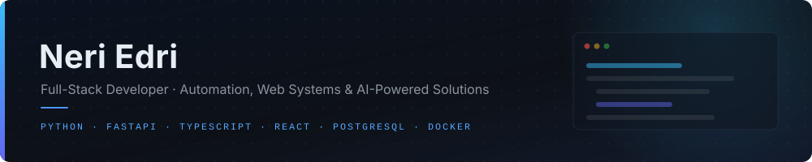

<picture>
  <source media="(prefers-color-scheme: dark)" srcset="assets/banner-dark.svg">
  <source media="(prefers-color-scheme: light)" srcset="assets/banner-light.svg">
  
</picture>

 

---

## About

I build software that comes out of real operational needs, not exercises. That includes an installer
behind 280+ real client installations that cut each setup from 45–80 minutes to about 22, an update
system with 200+ automated tests, an order and quote platform that ran a working business, and a
personal-finance engine that classifies and de-duplicates transactions.

Most of my work is full-stack **Python** and **TypeScript**: an async FastAPI or Next.js backend, a
React or Qt client on top, PostgreSQL underneath, and automation wherever a person would otherwise
repeat themselves. I spend my attention on the parts users never see — layered architecture,
background workers, encryption of sensitive fields, RTL-correct interfaces — because those are what
decide whether a tool survives contact with real use.

---

## Tech Stack

|                        |                                                                                                        |
| :--------------------- | :----------------------------------------------------------------------------------------------------- |
| **Languages**          | Python · TypeScript · JavaScript · SQL · PowerShell · HTML / CSS                                         |
| **Backend**            | FastAPI · SQLAlchemy 2.0 (async) · Alembic · Celery · Pandas · Next.js Route Handlers · Prisma · .NET    |
| **Frontend**           | React · Next.js · Tailwind CSS · Vite · TanStack Query · Zustand · React Hook Form · Zod · Recharts      |
| **Desktop**            | PySide6 / Qt · Tkinter · PyInstaller                                                                     |
| **Data**               | PostgreSQL · SQL Server · SQLite · Redis                                                                 |
| **Automation & AI**    | Playwright · AI-assisted classification · Telegram Bot API · WMI · Windows Registry                      |
| **Infra & DevOps**     | Docker · Docker Compose · Nginx · Vercel · Upstash Redis · Blob storage                                  |
| **Security**           | JWT + refresh tokens · bcrypt · AES-256-GCM field encryption · Rate limiting · Input sanitization         |

---

## Featured Projects

<table>
<tr>

<td width="50%" valign="top">

<h3>SQL Server Setup Wizard</h3>

<b>A Windows installer that turns a 45–80 minute manual setup into about 22 minutes.</b>

<b>Problem</b> — every new client of a commercial desktop software suite needed SQL Server installed and configured by hand: the installer, authentication, TCP/IP, firewall rules, folders and a backup restore. It was a long checklist, and every step could go wrong.

<b>Built</b> — a Hebrew RTL PySide6 wizard covering SQL Server 2017 through 2025. It scans the environment for existing instances, SSMS and ports, configures Mixed Mode and TCP/IP through WMI and the registry, and manages firewall rules and services via PowerShell. It also provisions folders and permissions, and restores backups. Long-running work runs on QThreads. Field fixes include Hebrew-collation conflicts and failed restores, and a support bundle with crash reporting is built in.

<b>Impact</b> — <b>280+ real client installations</b>, ~22 min each instead of 45–80. Backed by 40 pytest modules, CI/CD with security checks and tag-based releases.

<code>Python</code> <code>PySide6</code> <code>PowerShell</code> <code>WMI</code> <code>SQL Server</code> <code>GitHub Actions</code>

Closed source — described at a high level.

</td>

<td width="50%" valign="top">

<h3>Smart Update Manager</h3>

<b>Safe, coordinated updates for a multi-workstation desktop suite.</b>

<b>Problem</b> — the old updater only closed the programs on the machine that started the update. On other workstations, and on cloud and Terminal Server setups, programs stayed open while their files were being replaced.

<b>Built</b> — I started with a read-only review of the existing update flow, then wrote a decision log of 16 open questions for management and a technical spec. The result is a tray agent on every workstation that warns users, detects locked files and closes the suite's programs before installing. The updater reports which stations didn't close, and hooks into the product's core library were prototyped with the lead developer.

<b>Quality</b> — <b>200+ automated tests</b> against a mock update server, run against two versions of the core library. Rolling out internally first, then gradually to clients.

<code>C#</code> <code>.NET</code> <code>REST API</code> <code>PowerShell</code>

Closed source — described at a high level.

</td>

</tr>
<tr>

<td width="50%" valign="top">

<h3>SQL Server Config Generator</h3>

<b>A browser tool that writes SQL Server answer files for you.</b>

<b>Problem</b> — an unattended SQL Server install needs a hand-written <code>ConfigurationFile.ini</code>, and a single wrong key means rebuilding the machine.

<b>Built</b> — a 12-step wizard that renders the <code>.ini</code>, the <code>setup.exe</code> command and a PowerShell script live as you type. It includes instance-name validation, an SA-password strength meter, ZIP export and share links that encode the config in the URL. It also has an offline-capable PWA shell, full keyboard + ARIA support and a 28-assertion in-browser test suite. Everything runs client-side: nothing reaches a server, and the SA password is never persisted or placed in a share link.

<code>JavaScript</code> <code>HTML</code> <code>CSS</code> <code>PWA</code> <code>Service Worker</code>

<a href="https://github.com/neriedri/Generate-SQL-Server-Configuration_ini"><b>Code</b></a> ·
<a href="https://generate-sql-server-configuration-i.vercel.app/"><b>Live demo</b></a>

</td>

<td width="50%" valign="top">

<h3>FinCoreAI</h3>

<b>A personal finance and pension intelligence system with three surfaces.</b>

<b>Problem</b> — personal financial and pension data arrives as inconsistent statements that nobody wants to reconcile by hand.

<b>Built</b> — a layered architecture (FastAPI REST layer → service layer → SQLAlchemy data layer) serving two clients from one core: a PySide6 desktop app and a React/TypeScript web client. An intelligence engine handles rule-based and AI-assisted transaction classification, duplicate detection and inter-account transfer normalization. It also imports CSV/Excel via Pandas and shows a KPI dashboard. Credentials are bcrypt-hashed, and sensitive fields are encrypted with AES-256-GCM. The interface is RTL-first.

<code>Python</code> <code>FastAPI</code> <code>SQLAlchemy</code> <code>PySide6</code> <code>React</code> <code>TypeScript</code>

Closed source — described at a high level.

</td>

</tr>
<tr>

<td width="50%" valign="top">

<h3>Order &amp; Quote Center</h3>

<b>Orders and quotes for a local food business, end to end.</b>

<b>Problem</b> — a working business tracked orders and issued price quotes by hand, with no single source of truth.

<b>Built</b> — an async FastAPI backend over PostgreSQL (SQLAlchemy 2.0 async + asyncpg, 11 Alembic migrations), with JWT + refresh-token auth, request rate limiting, and Celery + Redis for background jobs and scheduling. Quotes render as Hebrew RTL PDFs and go out as transactional email. The frontend is React + TypeScript + Vite with TanStack Query, Zustand, React Hook Form + Zod and Recharts. The whole stack ships containerized behind Nginx. I owned it from spec to deployment, and it ran in production for the business.

<code>Python</code> <code>FastAPI</code> <code>PostgreSQL</code> <code>Celery</code> <code>Redis</code> <code>React</code> <code>Docker</code>

Closed source.

</td>

<td width="50%" valign="top">

<h3>Portfolio Platform</h3>

<b>My portfolio, built as a product rather than a static page.</b>

<b>Built</b> — a Next.js App Router site on React and Tailwind, backed by Postgres through Prisma. A custom admin area manages the projects, with server-side session checks, bcrypt-hashed credentials, CSRF protection, a Redis-backed login rate limiter and image uploads to Blob storage. It has a strict nonce-based CSP, is fully bilingual English / Hebrew with real RTL, supports light and dark themes, and ships an accessibility widget with a published accessibility statement.

<code>Next.js</code> <code>React</code> <code>TypeScript</code> <code>Tailwind CSS</code> <code>Prisma</code> <code>PostgreSQL</code>

<a href="https://github.com/neriedri/Portfolio-Website"><b>Code</b></a> ·
<a href="https://neria-edri.vercel.app"><b>Live site</b></a>

</td>

</tr>
<tr>

<td width="50%" valign="top">

<h3>Support Workflow Automator</h3>

<b>Takes the repetitive clicks out of support tickets.</b>

<b>Built</b> — a browser tool for a support team's CRM. It fills ticket templates by fault type, surfaces the matching standard operating procedure, and stamps time and status automatically, so agents spend their time on the problem rather than the paperwork.

<code>JavaScript</code> <code>Google Apps Script</code>

Closed source.

</td>

<td width="50%" valign="top">

<h3>More</h3>

Additional work — including browser-automation tooling and internal desktop utilities — is written up on my portfolio, with screenshots and full technical breakdowns.

<a href="https://neria-edri.vercel.app"><b>Browse all projects →</b></a>

 

A large share of what I build ships as private or client-owned software, so public repository activity under-represents the volume of the work. Happy to walk through architecture and decisions in a conversation.

</td>

</tr>
</table>

---

## What I Build

|      |      |
| :--- | :--- |
| **Automation & internal tooling** | Turning repeatable manual work — installs, configuration, sign-up flows, reporting — into guided tools and scheduled jobs. |
| **Business systems** | Orders, quotes, document generation and dashboards for businesses that are actually running on them. |
| **AI-assisted data products** | Classification, de-duplication and normalization pipelines over messy real-world financial data. |
| **Windows desktop applications** | Qt wizards that drive the operating system itself: services, registry, firewall rules and permissions. |
| **Install & update tooling** | Installers and updaters for multi-workstation software, with specs, decision logs, automated tests and staged rollouts. |

---

## How I Work

- **Privacy by construction.** The SQL config tool never sends data to a server and never persists the SA password; FinCoreAI encrypts sensitive fields at rest. The safest data is the data you never hold.
- **Layers before features.** Keeping the API, service and data layers separate is the reason one FinCoreAI core can serve both a Qt desktop app and a React web client without forking logic.
- **Never block the user.** Long work belongs on a QThread or a Celery worker — an interface that freezes is a bug, not a performance detail.
- **Localization is architecture.** Hebrew RTL is designed into the layout, the components and the generated PDFs from the start, not retrofitted as a translation file.
- **Spec before code.** The update manager started as a read-only review, a 16-question decision log and a written spec. Only then came code, with 200+ tests against a mock server.
- **Test the parts that can hurt you.** The public test suite targets share-link sanitization, password masking and validation logic first — the paths where a mistake is expensive.

---

## Contact

  

Open to interesting problems — automation, backend systems and AI-powered products.

